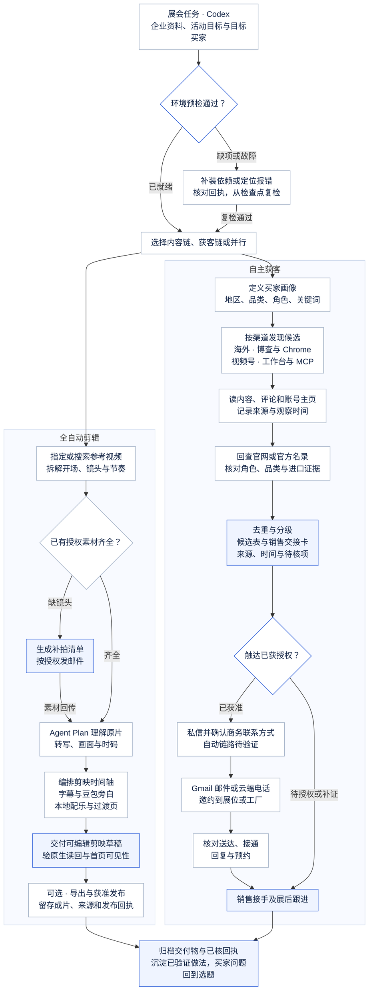

# ClipSignal — 面向外贸团队的融媒体获客技能套件

**ClipSignal 为外贸团队提供全自动剪辑和自主获客工作流。** 用工作区授权素材制作可编辑的剪映草稿，从公开社媒发现并核验买家，交给销售跟进。 首发场景是冠英商用车汽配展，销售可据此安排展位会面和湖州访厂。

[产品站（GitHub Pages）](https://yuxuan6426.github.io/clipsignal/) · [B1X 赛事页](https://b1x.work/events/competitions/cmp_d76ad4530fe1447d8707d3247ce5c7ad) · [安装指引](INSTALL.md) · [English](docs/readme-en.md)

[54 秒展台循环](https://yuxuan6426.github.io/clipsignal/demo/) · [4 分钟现场路演](https://yuxuan6426.github.io/clipsignal/demo/?mode=pitch)

## 在 Codex 发一句话

在 Windows 打开 Codex，将下面这句话粘贴到会话。

> 请从 https://github.com/yuxuan6426/clipsignal 安装并装载 ClipSignal，按仓库的 INSTALL.md 运行环境自检和合成候选验收，告诉我当前可用的模块和配置缺项。

Codex 会加载套件、预检环境并运行合成候选验收，告诉你哪些模块可用、还缺什么配置。[首次配置](docs/setup.md) · [合成样例](examples/index.md)

## 团队能接手什么

| 交付或结果 | 怎么用 |
| --- | --- |
| **全自动剪辑** | 参考可由用户提供或由 Agent 查找。用工作区已有素材制作可编辑草稿、字幕和预览。缺镜头时，按授权通过 Gmail 发送补拍清单，收到新素材后继续剪辑。 |
| **自主获客** | 用博查、Chrome 和视频号 MCP，从作品、评论与主页查找可能的买家。回查企业官网，分别核对品类、角色、进口能力和采购需求。交付候选表、Markdown 报告和 JSON，保留来源、观察时间与待核项。 |
| **邀约与销售交接** | 在获准场景中验证站内私信与商务联系方式确认。后续用 Gmail 邮件或云蝠智能外呼安排邀约，向销售交接回复、预约与到访记录。 |

自研的**微信视频号工作台与 MCP**随套件按 Apache-2.0 发布。Codex 可读取作品、可见评论和已关联账号，再接入同一套企业核验字段。[工作台源码与配置](modules/wechat/README.md)

<!-- hero:start -->

*AI 生成的产品场景示意。*
<!-- hero:end -->

## 两条链路，面向两类交接

两条链共用企业资料、买家画像和展会目标。可单独运行，也可在同一个任务里并行。

[完整工作流](docs/workflow.md) · [技术图解](docs/diagrams.md) · [自修复与项目记忆](docs/workflow.md#首次配置修复与复用)

## 冠英首发验证

22 秒双语剪映草稿已原生读回并人工确认首页可见。X 与 Facebook 的公开记录经官网核验后合为一个渠道候选，销售交接使用合成询盘验收。已验证视频号 MCP 读取、Gmail 测试邮件发送及通过 MCP 读取云蝠测试知识库。自动私信与联系方式确认、正式发布、邮件送达、实际外呼及到访在展会场景分别验证。

[查看七项能力的实证与待验](docs/test.md#七项能力的实证与待验)

## 服务来源与发布

电话销售与外呼由云蝠智能 VoiceAgent 提供。Windows Codex MCP 接入由 **yuxuan6426** 构建并提供接入支持。[云蝠智能官网](https://www.ccgpt.net/) · [yunfu-mcp-windows 仓库](https://github.com/yuxuan6426/yunfu-mcp-windows)

[Pages 部署指引](docs/pages.md) · [依赖与许可](docs/deps.md) · [Apache-2.0](LICENSE) · [Agent 检索入口](llms.txt)
