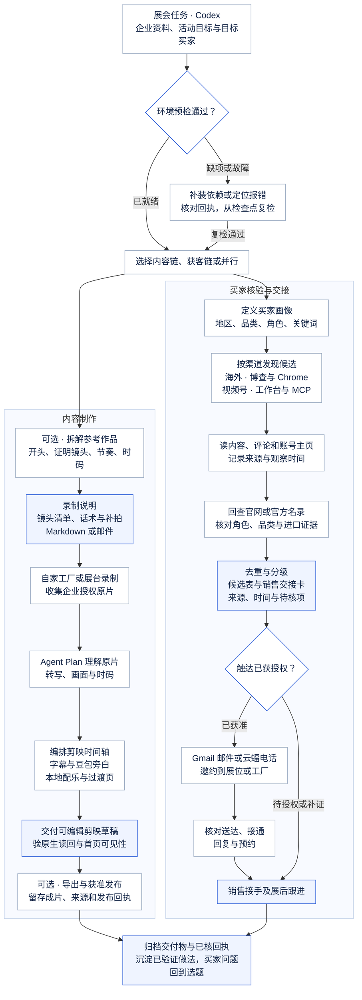
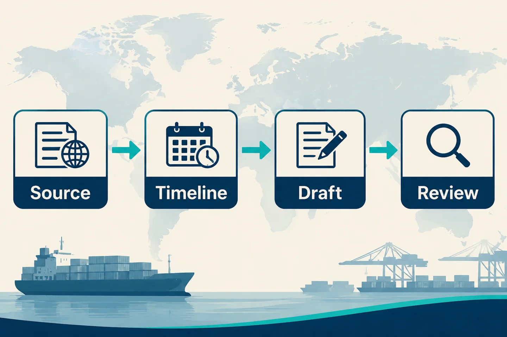
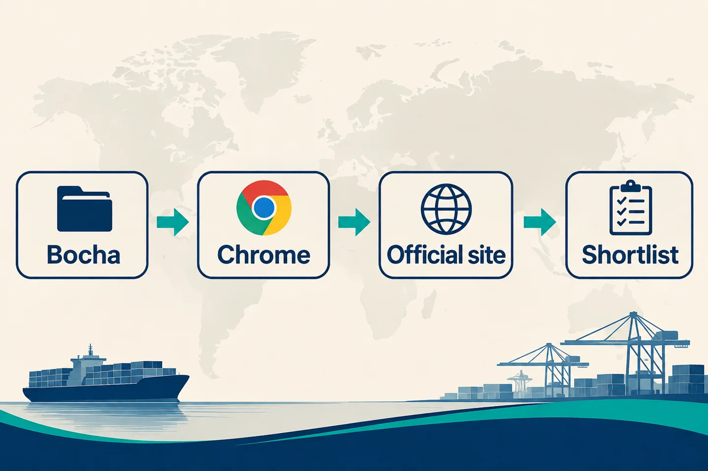
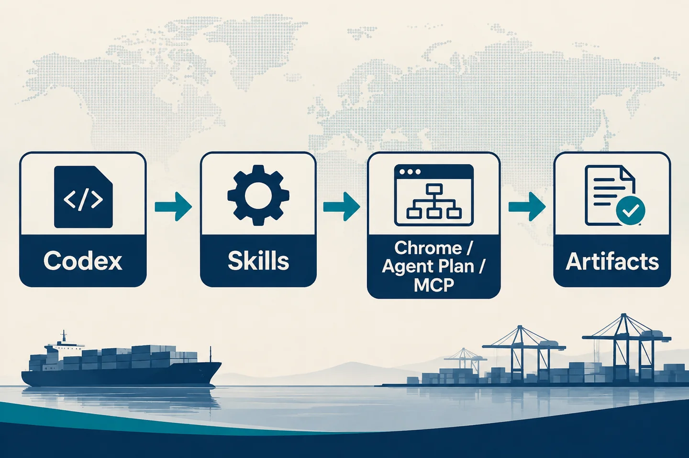
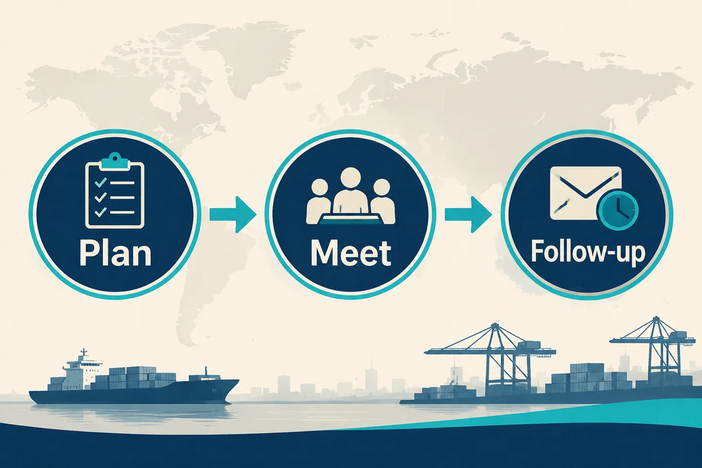
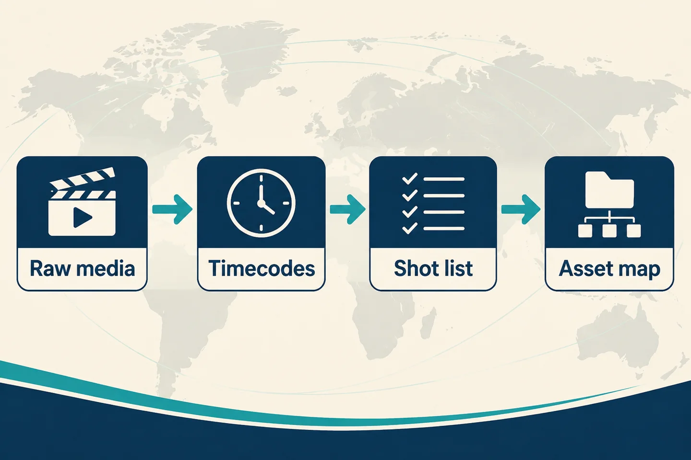
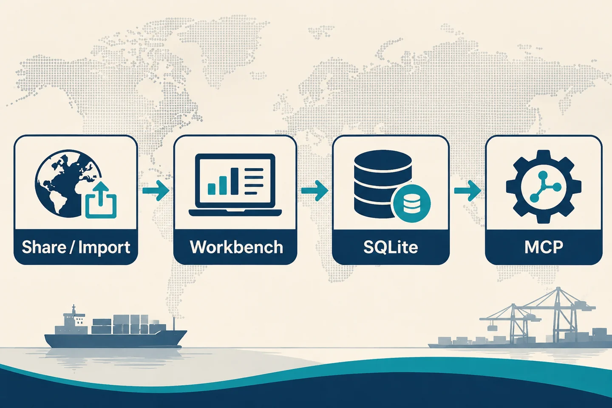
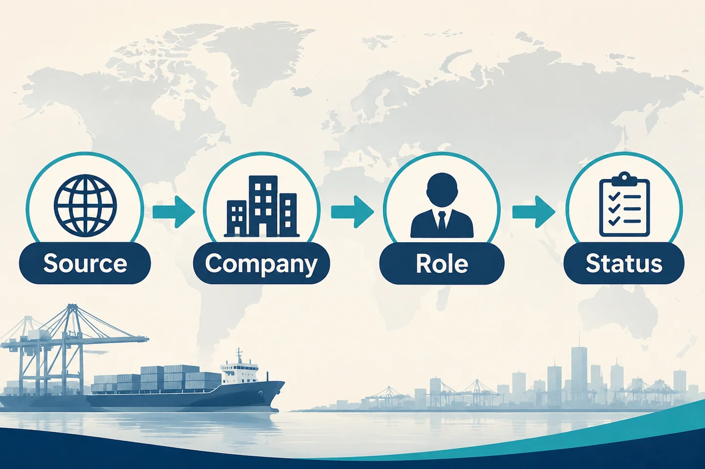
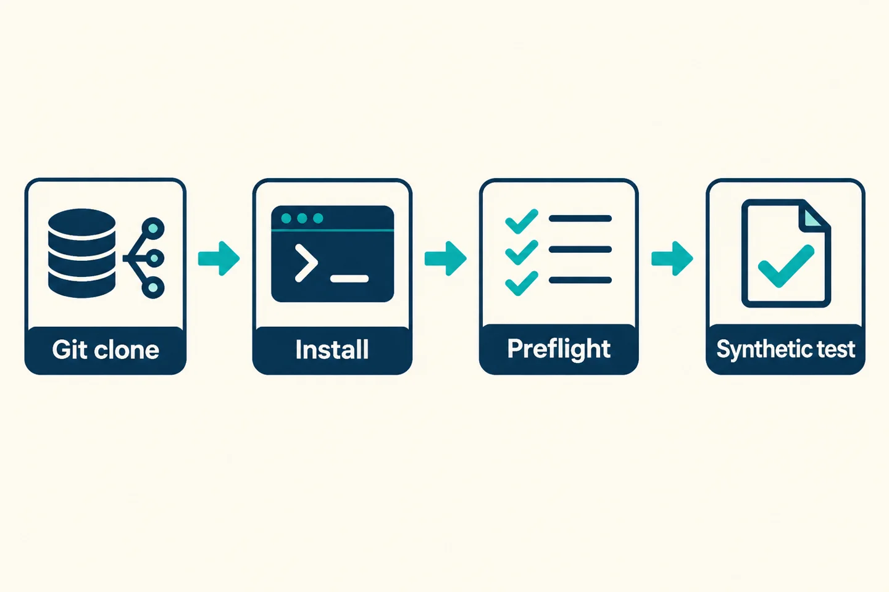

# ClipSignal — 面向外贸团队的融媒体获客技能套件

**从工厂或展台实拍，到可核验的买家和销售接手。** ClipSignal 是在 Windows Codex 里运行的技能套件。首发用于冠英商用车汽配展会，交付录制说明、可编辑剪映草稿和带证据的买家候选，支持按授权发布与邀约。

[一句话装载](INSTALL.md) · [双页产品站](docs/pages.md) · [工作流](docs/workflow.md) · [技术图册](docs/diagrams.md) · [English](docs/readme-en.md)

<!-- hero:start -->

*ClipSignal 产品场景插画，经本地 New API 生成。*
<!-- hero:end -->

## 在 Codex 发一句话

> 请从 https://github.com/yuxuan6426/clipsignal 安装并装载 ClipSignal，按仓库的 INSTALL.md 运行环境自检和合成候选验收，告诉我当前可用的模块和配置缺项。

Windows 上的 Codex 会话可直接读取装载入口。首次运行用自己的剪映安装、浏览器权限和业务服务凭据。[安装与配置](INSTALL.md) · [合成样例](examples/index.md)

## 两条链路，面向两类交接

两条链共用企业资料、买家画像和展会目标。可单独运行，也可在同一个任务里并行。

| 工作阶段 | 内容人员 | 获客与销售 |
| --- | --- | --- |
| 展前 | 参考拆解、录制说明、素材采集 | 买家画像、企业角色与品类筛选 |
| 展中 | 草稿、字幕、预览，按账号验证发布 | 复核公开商务联系方式，准备展位或工厂邀约 |
| 展后 | 整理作品与素材来源 | 分别记录回复、接通、预约和销售接手 |

### 内容制作

拆解参考作品的开场、卖点、证明镜头和节奏，转成带时码的 Markdown 录制说明，可按授权通过 Gmail 寄给拍摄同事。Agent Plan 分析企业授权原片，结合豆包 TTS 2.0 旁白、字幕、本地原创纯音乐与过渡页，制作可编辑的剪映草稿。交付预览与素材来源，分别验收首页登记、导出与获准发布。[内容工作流](docs/workflow.md#内容制作与发布)

### 海外企业核验

用博查发现入口，在连接的 Chrome 沿 X、Facebook、YouTube 的可见帖子、评论和作者主页追溯到企业。把产品匹配、角色、进口能力和主动需求分别核对，按已核主体去重，交付 JSON、Markdown 报告和带观察时间的候选表。明确且获准跟进的询盘进入销售交接。[买家核验](docs/workflow.md#买家发现与核验) · [合成候选输入](examples/leads.json)

### 微信视频号与邀约交接

独立视频号工作台用本机 SQLite 和 MCP 读取作品、可见评论及已有记录支持的账号关联。沿用企业核验和交接字段。Gmail 邮件和云蝠外呼按授权邀请买家见面或访厂，各自核对发送、接通、回复、预约和到访。冠英销售接手时可补问车桥、旧件号或样件并回查目录，由冠英确认适配与正式报价。[视频号工作台](modules/wechat/README.md) · [邀约与销售接手](docs/workflow.md#邀约与销售接手)

### 总控、首装与续跑

Codex 总控按任务预检模块与业务权限。从失败环节和原回执定位，查文档、修复并复验后续跑。交付通过后，工作区记忆收录经验证的做法和适用条件，供下一次任务自动查阅。[首次配置](docs/setup.md) · [运行与修复](docs/workflow.md#首次配置修复与复用)

## 系统与链路图册

| 技术关系 | 查看图解 |
| --- | --- |
| 总控、流程与素材 | [总体架构](docs/diagrams.md#系统架构) · [展会全景](docs/diagrams.md#展会全景) · [拍摄素材](docs/diagrams.md#拍摄素材结构) · [剪映链](docs/diagrams.md#剪映制作链) |
| 场景、证据与回执 | [海外核验](docs/diagrams.md#海外企业核验链) · [视频号 MCP](docs/diagrams.md#视频号-mcp-链) · [候选证据](docs/diagrams.md#候选证据结构) · [触达回执](docs/diagrams.md#发布与触达回执) |
| 装载与维护 | [首次装载](docs/diagrams.md#首次装载与依赖) · [故障恢复和记忆](docs/diagrams.md#修复与项目记忆) |

展开 · 故障恢复与项目记忆

<!-- tech:start -->
### 剪映制作链

### 海外企业核验链

查看总体架构及其余图示

**系统架构**

**展会全景**

**拍摄素材结构**

**视频号 MCP 链**

**候选证据结构**

**发布与触达回执**

**首次装载与依赖**

**修复与项目记忆**

<!-- tech:end -->

<!-- showcase:start -->
## 展会场景图册

从展前准备到展后接手 · AI 场景插画

| | |
| --- | --- |
|  |  |
|  |  |
|  |  |
|  |  |
|  |  |

<!-- showcase:end -->

## 实测与复跑

冠英案例已验证 22 秒双语草稿首页人工确认、X 与 Facebook 同一企业核验和合成询盘交接。另有 Gmail 自验发送、云蝠知识库读回、视频号 MCP 作品与评论读取。正式成片发布、邮件收件、外呼接通和到访按展会现场回执分别验收。[验收步骤](docs/test.md) · [Agent Research](docs/research.md) · [分发清单](delivery.json)

[依赖](docs/deps.md) · [Apache-2.0](LICENSE) · [Agent 检索入口](llms.txt)
