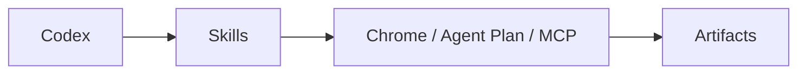
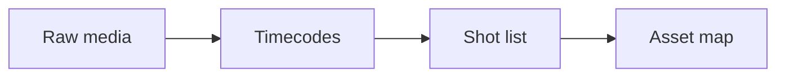
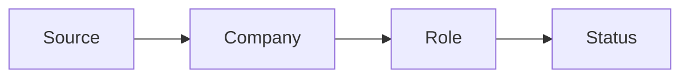
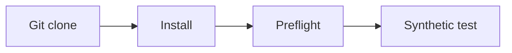
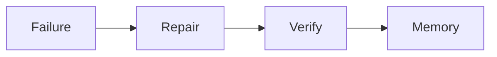

# ClipSignal 技术图册

## 系统架构

## 展会全景

## 拍摄素材结构

## 剪映制作链

## 海外企业核验链

## 视频号 MCP 链

## 候选证据结构

## 发布与触达回执

## 首次装载与依赖

## 修复与项目记忆

发送、发布、计费或外呼状态未知时，先查服务回执。用各阶段验收时的实际状态判断接手和续跑。 [工作流](workflow.md)