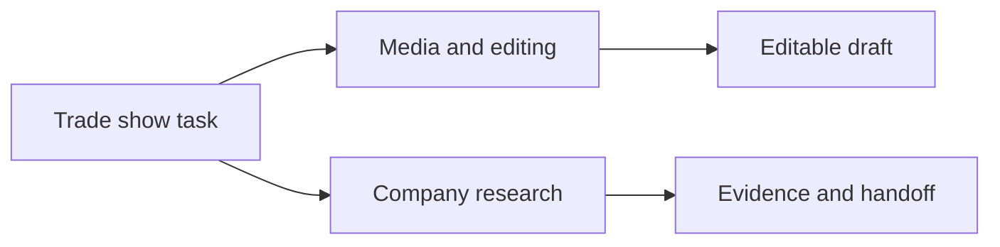

# ClipSignal — trade content and buyer research

ClipSignal is a Windows Codex toolkit for trade-show content and buyer research. Teams can produce an editable Jianying draft from their own factory or booth footage, verify buyer companies, and hand leads to sales for authorized outreach. Zhejiang Kooying's commercial-vehicle brake components are the first case.

[Install](../INSTALL.md) · [Product site](pages.md) · [Technical diagrams](diagrams.md) · [中文](../README.md)

<!-- hero:start -->

*AI-generated product illustration.*
<!-- hero:end -->

## Start in Codex

> Install and load ClipSignal from https://github.com/yuxuan6426/clipsignal. Follow INSTALL.md, run the core preflight and the synthetic candidate test, and report ready modules and missing configuration.

| Workflow | Input | Deliverable |
| --- | --- | --- |
| Content | Audience, reference works and authorized footage | Markdown shot brief, timestamped sources, editable Jianying draft, bilingual preview and captions |
| Buyer research | Market, product, buyer role and keywords | Deduplicated companies with separate evidence for product fit, buyer role, import capability and purchase intent |
| WeChat Channels | Authorized records and visible public material | Local workbench and MCP reads for works, visible comments and recorded account associations |
| Outreach and handoff | Verified business channels and authorization | Gmail or Cloudbat outreach, appointment and visit records, with a sales handoff for qualified inquiries |
| Setup and recovery | Windows Codex workspace and module prerequisites | Preflight, checkpoint recovery and reuse of verified project knowledge |

<!-- showcase:start -->

Illustrated workflows

| | |
| --- | --- |
|  |  |
|  |  |

<!-- showcase:end -->

## How the workflows connect

The content workflow analyzes reference openings, proof shots and pacing, then uses Agent Plan to transcribe and analyze authorized footage. Jianying drafts can include Doubao narration, captions, locally produced original music and transition pages. A separate authorized stage checks export and publication receipts.

Bocha discovers starting points. Connected Chrome follows visible posts, comments and author pages on X, Facebook and YouTube. The workflow checks official company sources and keeps JSON evidence, Markdown reports and a buyer shortlist. In Kooying's brake-lining example, sales asks for the current axle, existing part number or sample before checking the catalog. Kooying confirms fit and the formal quote.

## Verified results

The Kooying run verified a 22-second bilingual draft on the Jianying home screen, one company checked across X and Facebook, and a synthetic inquiry handoff. Gmail self-test sending, Cloudbat knowledge-base readback, and WeChat MCP work and comment reads were checked separately. Live validation tracks publication, email receipt, answered calls and visits as separate outcomes.

## Workflow diagrams

**ClipSignal system architecture**

**Company verification**

[Workflow](workflow.md) · [Acceptance](test.md) · [Agent research](research.md) · [Dependencies](deps.md)
