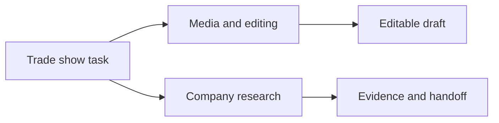
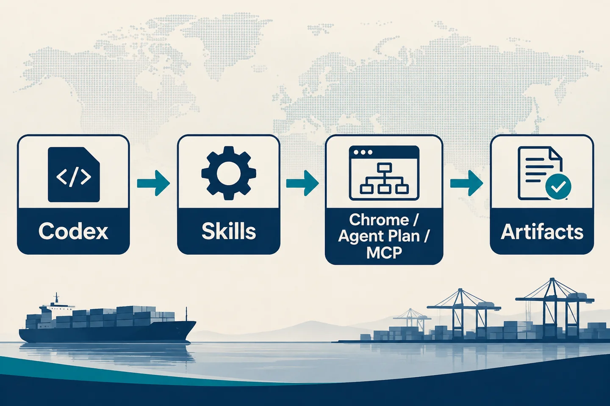
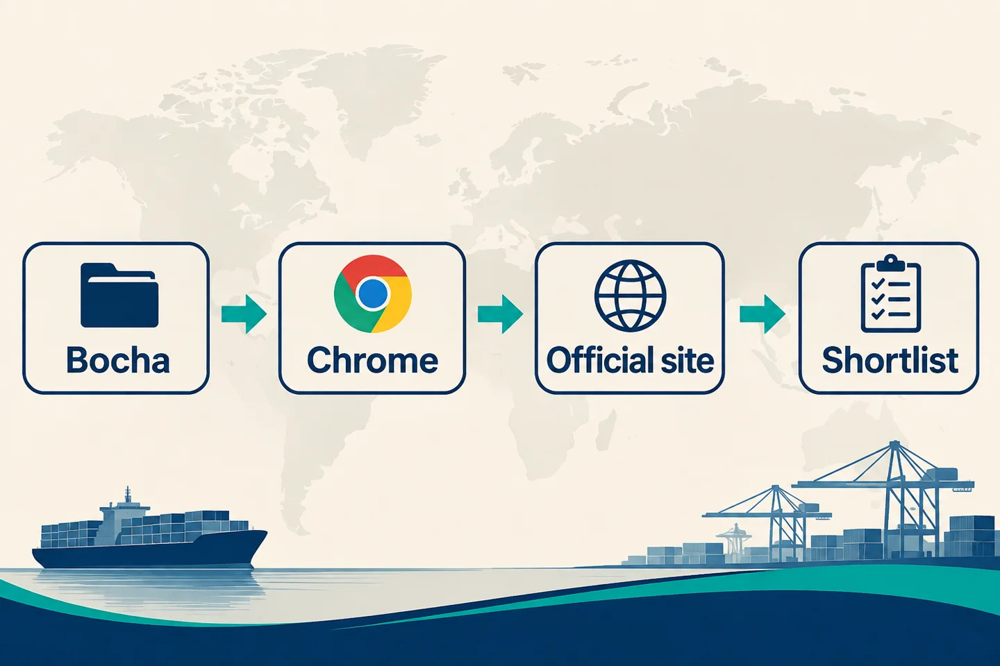

# ClipSignal — trade content and buyer research

ClipSignal gives trade show teams two independently usable workflows: editable media drafts and verifiable company leads. Keep the source, observed result, and handoff for each step.

[Install](../INSTALL.md) · [Product site](pages.md) · [Technical diagrams](diagrams.md) · [中文](../README.md)

<!-- hero:start -->

*AI-generated product illustration.*
<!-- hero:end -->

## Start in Codex

> Install and load ClipSignal from https://github.com/yuxuan6426/clipsignal. Follow INSTALL.md, run the core preflight and the synthetic candidate test, and report ready modules and missing configuration.

| Workflow | Input | Deliverable |
| --- | --- | --- |
| Content | Reference works and authorized footage | Shot brief, timestamped evidence, editable Jianying draft |
| Research | Market, product, buyer role, keywords | Deduplicated company candidates with sources and review state |
| WeChat Channels | Authorized records and visible public material | Local workbench and MCP detail and comment reads |
| Handoff | Verified business channels and authorization | Outreach and publication receipts, each verified separately |

<!-- showcase:start -->

Illustrated workflows

| | |
| --- | --- |
|  |  |
|  |  |

<!-- showcase:end -->

## Workflow diagrams

**ClipSignal system architecture**

**Company verification**

[Workflow](workflow.md) · [Acceptance](test.md) · [Agent research](research.md) · [Dependencies](deps.md)